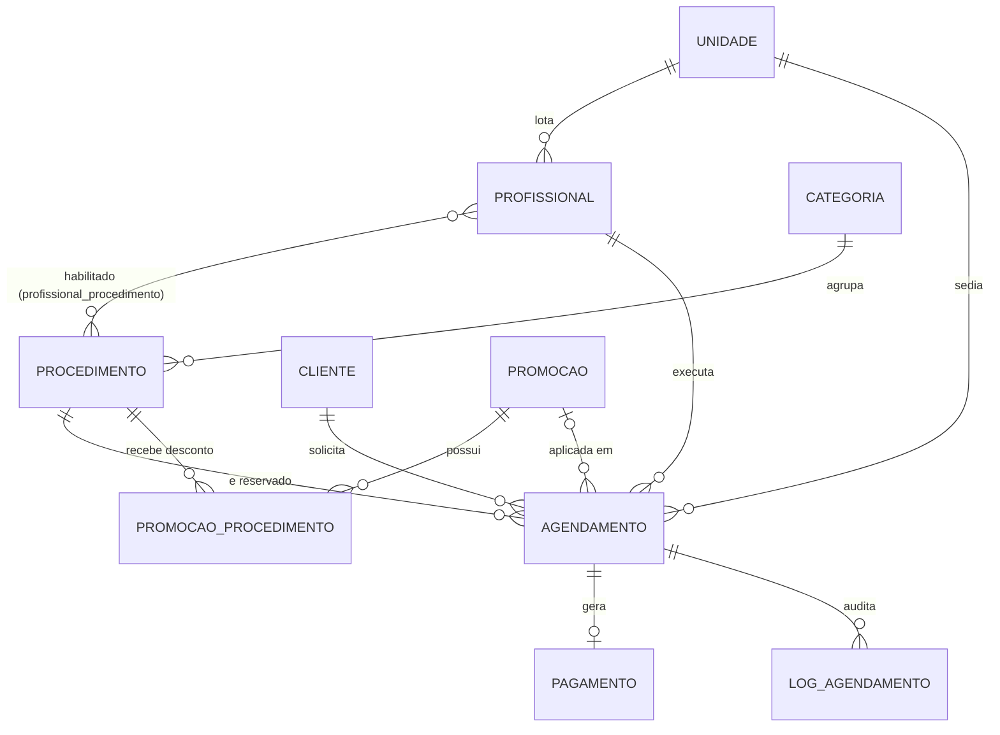

# AP3 – Projeto Final | Banco de Dados da Clínica Estética Pure Touch

Disciplina de Banco de Dados – FAETERJ-Rio · Trabalho individual

Projeto de origem: protótipo de IHM da clínica **Pure Touch**, criado no Figma. O site tem as seções
*Estética Facial* (preenchimento facial, toxina botulínica, harmonização facial, preenchimento labial),
*Estética Corporal* (preenchimento corporal, massagem modeladora, drenagem linfática, radiofrequência),
*Unidades*, *Sobre*, botão **Agende sua consulta**, área de login do cliente e o banner **Black Friday – até 50% de desconto**.

Este trabalho constrói o **back-end de dados** que sustentaria esse site: modelo de domínio (DDD), esquema (DDL),
procedures/funções/triggers/views e a orquestração do banco (Docker Compose e OpenShift).

---

## 1. Requisitos extraídos do protótipo

| Elemento do site | Requisito de dados |
|---|---|
| Menus Estética Facial / Corporal e cards | Catálogo de procedimentos por categoria, com preço e duração |
| "Unidades" | Cadastro de unidades e profissionais por unidade |
| "Agende sua consulta" | Agendamento sem conflito de horário, com validação de regras |
| Ícone de usuário / Entrar | Cadastro e autenticação de clientes (senha com hash) |
| Banner Black Friday "até 50%" | Campanhas promocionais com teto de 50% |
| Gestão da clínica (implícito) | Conclusão de atendimento, pagamento, faltas e relatórios |

## 2. Modelo de domínio (DDD)

> **Nota:** o enunciado traz "DDD". Este trabalho cobre as duas leituras: a modelagem **Domain-Driven Design**
> (esta seção) e os scripts de definição de dados **DDL** (`sql/01_ddl.sql`).

### 2.1 Linguagem ubíqua

| Termo | Significado |
|---|---|
| Procedimento | Serviço estético oferecido (ex.: Toxina Botulínica), pertence a uma Categoria |
| Agendamento | Reserva de um Procedimento, com um Profissional, em uma Unidade, em um intervalo de tempo |
| Profissional | Quem executa procedimentos; está lotado em uma Unidade e só executa procedimentos habilitados |
| Campanha (Promoção) | Período com percentuais de desconto por procedimento (máx. 50%) |
| Atendimento concluído | Agendamento realizado e pago |

### 2.2 Contextos delimitados (Bounded Contexts)

```
┌───────────────┐   ┌────────────────┐   ┌───────────────┐
│   CATÁLOGO    │   │  AGENDAMENTO   │   │   CLIENTES    │
│ Categoria     │◄──│ Agendamento *  │──►│ Cliente *     │
│ Procedimento *│   │ (raiz)         │   │               │
└───────────────┘   └───────┬────────┘   └───────────────┘
        ▲                   │
┌───────┴───────┐   ┌───────▼────────┐   ┌───────────────┐
│  PROMOÇÕES    │   │   FINANCEIRO   │   │    EQUIPE     │
│ Promocao *    │   │ Pagamento      │   │ Unidade       │
│ (itens)       │   │                │   │ Profissional *│
└───────────────┘   └────────────────┘   └───────────────┘
                    * = raiz de agregado
```

### 2.3 Agregados e invariantes

| Agregado (raiz) | Invariantes garantidas | Onde é garantido |
|---|---|---|
| **Agendamento** (+ Pagamento, log) | Sem sobreposição de horário por profissional nem por cliente; `fim > inicio`; cancelado exige motivo; só transita AGENDADO → CONCLUIDO/CANCELADO/FALTOU | `EXCLUDE USING gist`, `CHECK`, procedures |
| **Cliente** | CPF único e com 11 dígitos; e-mail único e válido; maior de 18 anos; senha nunca em texto puro | `UNIQUE`, `CHECK`, `sp_cadastrar_cliente` + `pgcrypto` |
| **Promoção** (+ itens) | Desconto entre 0 e 50%; vigência coerente (`fim >= inicio`) | `CHECK`, `sp_ativar_campanha` |
| **Procedimento** | Duração 15–240 min; preço ≥ 0 | `CHECK` |
| **Profissional** | Registro em conselho único; só atende procedimentos habilitados | `UNIQUE`, `profissional_procedimento` |

Decisão de projeto: o **valor do agendamento é congelado** no momento da reserva (`valor_tabela`, `percentual_desconto`,
`valor_final`). Assim, mudanças futuras de preço ou campanha não alteram o histórico (princípio de imutabilidade de
valores já contratados).

## 3. Modelo de dados



Escolhas relevantes:

* **PostgreSQL 15/16**, o mesmo SGBD usado na AP2 (OpenShift Developer Sandbox).
* **Chaves substitutas** com `GENERATED ALWAYS AS IDENTITY`.
* **`EXCLUDE USING gist` com `tsrange`**: a regra "dois atendimentos não podem se sobrepor" fica no banco e vale mesmo se duas
  requisições concorrentes tentarem reservar o mesmo horário (uma verificação feita só na aplicação teria condição de corrida).
* **Normalização (3FN):** categorias, unidades e habilitações em tabelas próprias; os valores gravados no agendamento são
  uma desnormalização deliberada (histórico financeiro).
* **Segurança:** senha com `crypt(..., gen_salt('bf'))` (bcrypt).

## 4. Procedures, funções, triggers e views (`sql/02_procedures.sql`)

| Objeto | Tipo | O que faz |
|---|---|---|
| `sp_cadastrar_cliente` | PROCEDURE | Valida idade ≥ 18 e senha ≥ 8 caracteres, grava hash, trata CPF/e-mail duplicado |
| `sp_agendar_atendimento` | PROCEDURE | Valida cliente, procedimento, profissional habilitado, futuro e expediente (seg–sáb, 09h–18h); aplica a melhor promoção; trata conflito de horário |
| `sp_cancelar_agendamento` | PROCEDURE | Exige motivo e antecedência mínima de 2 h; só cancela AGENDADO |
| `sp_concluir_atendimento` | PROCEDURE | Em uma transação: marca CONCLUIDO e registra o pagamento |
| `sp_marcar_faltas` | PROCEDURE (**cursor**) | Percorre agendamentos vencidos e marca FALTOU; devolve a quantidade |
| `sp_ativar_campanha` | PROCEDURE (**cursor**) | Cria a campanha (ex.: Black Friday) com percentual por categoria, limitado a 50% |
| `sp_encerrar_campanha` | PROCEDURE | Desativa a campanha |
| `fn_melhor_promocao` | FUNCTION | Maior desconto vigente de um procedimento na data |
| `fn_valor_com_desconto` | FUNCTION | Preço final de um procedimento na data |
| `fn_horarios_livres` | FUNCTION | Horários disponíveis (passos de 30 min) para a tela de agendamento |
| `trg_log_status_agendamento` | TRIGGER | Registra em `log_agendamento` cada mudança de status |
| `vw_agenda`, `vw_faturamento_mensal`, `vw_ranking_procedimentos` | VIEWS | Agenda, faturamento por unidade/mês e ranking de procedimentos |

Cada procedure roda em uma única transação: se uma regra falhar, nada é gravado.

## 5. Orquestração

### 5.1 Local – Docker Compose (`docker-compose.yml`)

Sobe o **PostgreSQL 16** (com os scripts 01–03 executados automaticamente na primeira subida) e o **pgAdmin** em
`http://localhost:8080`. O banco tem *healthcheck* e o pgAdmin só inicia depois que ele está saudável (`depends_on`).

```bash
docker compose up -d
docker compose exec db psql -U puretouch -d puretouch -f /dev/stdin < sql/04_testes.sql
```

### 5.2 Nuvem – OpenShift (Red Hat Developer Sandbox) (`openshift/`)

| Manifesto | Recurso | Função |
|---|---|---|
| `01-secret.yaml` | Secret | Usuário, senha e nome do banco (fora do código) |
| `02-postgres.yaml` | PVC + Deployment + Service | Banco persistente (1 Gi), `strategy: Recreate` por causa do volume RWO, probes de readiness/liveness, limites de CPU/memória |
| `03-job-init.yaml` | Job | Espera o banco ficar pronto e aplica os scripts SQL (via ConfigMap) |
| `04-cronjob-faltas.yaml` | CronJob | Executa `sp_marcar_faltas()` todos os dias às 21h |

```bash
oc login ...                # comando de login copiado do console do Sandbox
./openshift/deploy.sh
```

Por que essa organização: o **Secret** separa credenciais da configuração; o **PVC** preserva os dados se o pod reiniciar;
o **Job** torna a inicialização repetível e automática; o **CronJob** mostra uma rotina de negócio agendada pelo
orquestrador, em vez de depender de alguém executar à mão.

## 6. Como executar e testar

```bash
psql -d puretouch -f sql/01_ddl.sql
psql -d puretouch -f sql/02_procedures.sql
psql -d puretouch -f sql/03_seed.sql      # dados fictícios
psql -d puretouch -f sql/04_testes.sql    # roteiro T1–T11
```

`docs/saida_testes.txt` traz a saída completa da execução. Resumo dos testes:

| Teste | Cenário | Resultado |
|---|---|---|
| T1 | Black Friday 50% facial / 30% corporal (cursor) | Preços com desconto corretos |
| T2 | Horários livres do profissional | Slots a partir de 09h |
| T3 | Agendamento válido | Toxina R$ 900 → R$ 450 (50%) |
| T4 | Mesmo profissional, horário sobreposto | Rejeitado |
| T5 | Profissional não habilitado | Rejeitado |
| T6 | Horário no passado / fora do expediente | Rejeitados |
| T7 | Menor de idade / CPF duplicado | Rejeitados |
| T8 | Cancelamento com antecedência | Aceito, status e log atualizados |
| T9 | Conclusão + pagamento; marcação de faltas (cursor) | 1 concluído, 1 falta |
| T10 | Auditoria por trigger | Todas as transições registradas |
| T11 | Views de relatório | Faturamento e ranking corretos |

## 7. Limitações e evolução

* Os dados de unidades, profissionais e clientes são **fictícios** (o protótipo do Figma não define esses dados).
* Não há API/aplicação: o foco é a camada de dados. Um próximo passo natural é uma API (Node/Express) chamando as
  procedures, como na AP2, e o login do site usando `crypt(senha, senha_hash)` para conferir a senha.
* O expediente (09h–18h) e a antecedência de cancelamento (2 h) estão fixos nas procedures; poderiam virar tabela de parâmetros.
* Evolução do modelo: agenda de disponibilidade por profissional, pacotes de sessões e avaliações de clientes.
